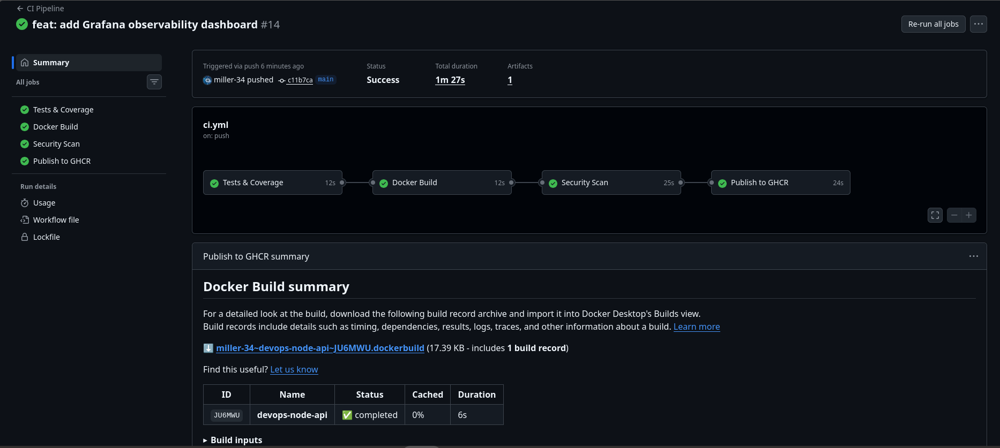
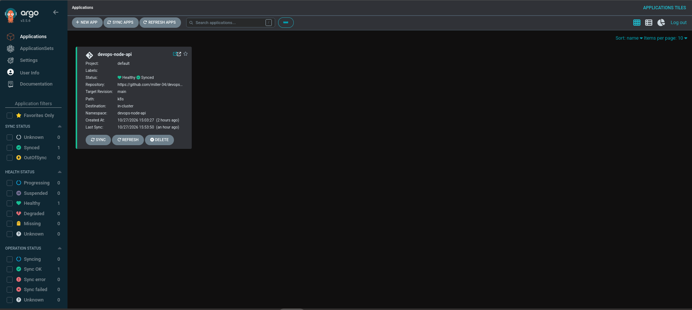
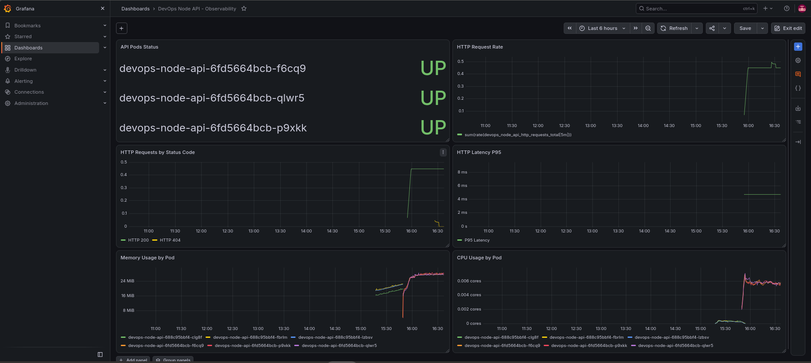

# DevOps Node API

Projeto de portfólio DevOps/DevSecOps que demonstra um fluxo completo de desenvolvimento, integração contínua, segurança, containerização, publicação de imagens, orquestração Kubernetes, GitOps e observabilidade.

A aplicação consiste em uma API REST desenvolvida em Node.js e Express, utilizada como base para implementar e demonstrar práticas modernas de CI/CD e operação de aplicações em Kubernetes.

## Arquitetura

```text
Developer
    │
    │ git push
    ▼
GitHub
    │
    ▼
GitHub Actions
    │
    ├── Tests & Coverage
    ├── Docker Build
    ├── Trivy Security Scan
    └── Publish to GHCR
             │
             ▼
     GitHub Container Registry
             │
             ▼
          Kubernetes
             │
      ┌──────┴──────┐
      │             │
   Argo CD      Gateway API
   GitOps        + Envoy
      │             │
      └──────┬──────┘
             │
      DevOps Node API
        (3 replicas)
             │
             ▼
       ServiceMonitor
             │
             ▼
        Prometheus
             │
             ▼
          Grafana
```

## Tecnologias

- Node.js 22
- Express
- Jest
- Supertest
- Docker
- GitHub Actions
- Trivy
- GitHub Container Registry (GHCR)
- Kubernetes
- Kind
- Gateway API
- Envoy Gateway
- Argo CD
- Prometheus
- Grafana
- Helm

## API

A aplicação disponibiliza endpoints para validação da API e monitoramento.

| Endpoint | Descrição |
|---|---|
| `/` | Informações básicas da aplicação |
| `/health` | Health check da aplicação |
| `/api/status` | Status e ambiente da API |
| `/api/projects` | Lista demonstrativa de projetos |
| `/metrics` | Métricas no formato Prometheus |

Exemplo:

```bash
curl http://localhost:3000/health
```

Resposta:

```json
{
  "status": "healthy",
  "uptime": 120.42,
  "timestamp": "2026-10-27T20:00:00.000Z"
}
```

## CI/CD com GitHub Actions

Cada alteração enviada para o repositório executa automaticamente o pipeline definido em:

```text
.github/workflows/ci.yml
```

O pipeline executa quatro etapas sequenciais:

1. **Tests & Coverage** — instalação das dependências, testes automatizados e cobertura.
2. **Docker Build** — construção e validação da imagem da aplicação.
3. **Security Scan** — análise de vulnerabilidades da imagem com Trivy.
4. **Publish to GHCR** — publicação da imagem no GitHub Container Registry.

### Pipeline executado com sucesso



## Containerização

A aplicação utiliza uma imagem baseada em Node.js Alpine e um Dockerfile multi-stage.

Entre as medidas de segurança aplicadas estão:

- execução da aplicação como usuário não-root;
- remoção do npm e npx da imagem final;
- instalação apenas das dependências necessárias para produção;
- imagem runtime reduzida;
- análise de vulnerabilidades com Trivy.

A imagem é publicada no GitHub Container Registry:

```text
ghcr.io/miller-34/devops-node-api
```

## Kubernetes

A aplicação é executada em Kubernetes utilizando manifests declarativos armazenados no diretório:

```text
k8s/
```

O ambiente inclui:

- namespace dedicado;
- Deployment;
- 3 réplicas da aplicação;
- Service ClusterIP;
- requests e limits de CPU e memória;
- readiness probe;
- liveness probe;
- security context;
- Gateway API;
- HTTPRoute;
- ServiceMonitor.

O container é executado sem privilégios e com capabilities removidas.

## Gateway API

O acesso HTTP à aplicação utiliza Kubernetes Gateway API com Envoy Gateway.

Fluxo:

```text
Client
  │
  ▼
Gateway
  │
  ▼
HTTPRoute
  │
  ▼
Service
  │
  ▼
Pods
```

Essa abordagem substitui o modelo tradicional baseado exclusivamente em Ingress e demonstra o uso da API moderna de roteamento do Kubernetes.

## GitOps com Argo CD

O deployment é gerenciado de forma declarativa pelo Argo CD.

A definição da aplicação está disponível em:

```text
argocd/application.yaml
```

O Argo CD monitora a branch `main` e sincroniza automaticamente os manifests presentes em `k8s/`.

A configuração utiliza:

- automated sync;
- self-healing;
- pruning de recursos removidos;
- criação automática do namespace.

Uma alteração no número de réplicas foi realizada exclusivamente através do Git, permitindo que o Argo CD detectasse e aplicasse automaticamente a mudança no cluster.

### Aplicação sincronizada



## Observabilidade

A aplicação possui instrumentação para Prometheus.

O endpoint:

```text
/metrics
```

expõe métricas da aplicação e do runtime Node.js.

Entre as métricas customizadas estão:

```text
devops_node_api_http_requests_total
devops_node_api_http_request_duration_seconds
```

Um `ServiceMonitor` permite que o Prometheus descubra e colete automaticamente as métricas da aplicação dentro do Kubernetes.

## Grafana

Foi criado o dashboard:

**DevOps Node API - Observability**

O dashboard apresenta:

- status dos pods;
- taxa de requisições HTTP;
- requisições agrupadas por status code;
- latência HTTP P95;
- utilização de memória por pod;
- utilização de CPU por pod.

### Dashboard de observabilidade



O dashboard também é mantido como código no repositório:

```text
observability/grafana/devops-node-api-dashboard.json
```

## Executando localmente

Clone o repositório:

```bash
git clone git@github.com:miller-34/devops-node-api.git
cd devops-node-api
```

Instale as dependências:

```bash
npm ci
```

Execute os testes:

```bash
npm test
```

Execute a aplicação:

```bash
npm start
```

A API estará disponível na porta `3000`.

```bash
curl http://localhost:3000/health
```

## Executando com Docker

Construa a imagem:

```bash
docker build -t devops-node-api .
```

Execute o container:

```bash
docker run --rm -p 3000:3000 devops-node-api
```

Teste:

```bash
curl http://localhost:3000/health
```

## Estrutura do projeto

```text
devops-node-api/
├── .github/
│   └── workflows/
│       └── ci.yml
├── argocd/
│   └── application.yaml
├── docs/
│   └── images/
├── k8s/
│   ├── deployment.yaml
│   ├── gatewayclass.yaml
│   ├── gateway.yaml
│   ├── httproute.yaml
│   ├── namespace.yaml
│   ├── servicemonitor.yaml
│   └── service.yaml
├── observability/
│   └── grafana/
│       └── devops-node-api-dashboard.json
├── src/
│   ├── app.js
│   ├── metrics.js
│   └── server.js
├── tests/
│   └── app.test.js
├── Dockerfile
├── package.json
└── package-lock.json
```

## Práticas demonstradas

Este projeto demonstra na prática:

- Continuous Integration;
- Continuous Delivery;
- testes automatizados;
- containerização;
- análise de vulnerabilidades;
- publicação automatizada de imagens;
- Kubernetes;
- workloads executados sem root;
- health checks;
- resource requests e limits;
- Gateway API;
- GitOps;
- reconciliação automática com Argo CD;
- métricas de aplicação;
- monitoramento com Prometheus;
- dashboards com Grafana;
- Infrastructure/Application Configuration as Code.

## Autor

**Miller Silva**

DevOps | CI/CD | Docker | Kubernetes | GitOps | Observability
